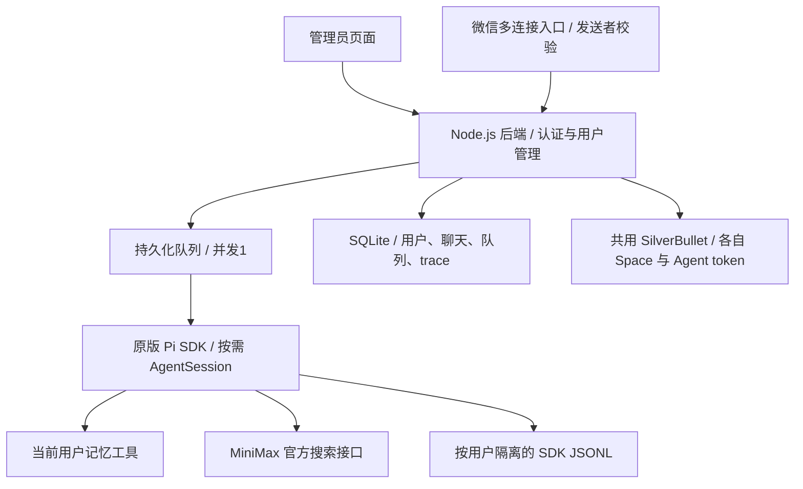

# pi-agent-multi-tenant

一键连接微信的多租户个人助手。目标是一个管理员控制台、一个 Pi SDK 后端、按用户隔离的数据，以及共用的 SilverBullet 等基础服务。

**当前版本：第二阶段本地开发版，尚未完成真实微信收发验收。** 第一阶段已上传 GitHub 并部署过独立开发实例；第二阶段未部署到服务器。个人助手发生无回复和服务器连接超时，用户正在重启服务器，当前暂停远程操作，故障原因未确定。

## 已实现

- 管理员登录、创建普通用户、用户列表；没有用户聊天页面。
- 服务端认证确定身份，客户端传入的 `userId` 不会切换身份。
- 独立的记忆、聊天、会话恢复和 trace；跨用户的资源 ID 返回 404。
- 一个 Pi SDK 服务进程，全局串行执行；持久化队列，上限20条，每用户等待上限5条。
- 使用原版 Pi SDK 1.1.0 创建独立 `AgentSession`，每次运行完成后释放；按用户保存 JSONL 会话。
- 显式资源和凭据配置，不发现宿主机的 AGENTS、技能、扩展、默认会话或生产记忆。
- 只开放当前用户的 `memory_read`、`memory_write`，以及可选 MiniMax 官方 `web_search`；没有宿主机 bash/read/write。
- Trace 保存注入提示词、记忆、SDK消息及工具事件；尚未复用旧 trace 网页，也不宣称已捕获全部原始 HTTP 请求。
- 密码 scrypt、会话 token 只存摘要、过期和退出撤销、HttpOnly/SameSite Cookie、请求体与登录并发限制。
- 管理员按用户生成微信二维码、查看扫码状态、取消和解绑；连接按用户独立长轮询，支持文本和语音转写文本。
- 微信发送者先校验再写入队列，持久化游标与消息去重；回复失败留在数据库重试。稳定发送ID不代表微信接口提供严格的恰好一次投递，网络故障时仍可能重复回复。
- 解绑保留微信身份归属，重新绑定必须是原微信用户，不能换人继承记忆。原个人助手身份可加入保护名单，不导入其微信token或聊天。
- 自动创建 SilverBullet 人类账号、非管理员 Agent 账号、私有 Space 和受限 token；模型只获得当前用户的 `note_read`、`note_write` 工具。
- 笔记写入使用 ETag 防止覆盖其他修改；管理员可显式查看人类登录信息，Agent token 不返回管理页面或模型。

## 仍需实现

1. 真实微信扫码、接收和回复验收，包括会话过期、重连及异常网络；目前只有模拟微信测试通过。
2. 第二阶段服务器部署、重启验收与资源评估；SilverBullet 实际隔离已在本地独立容器验证。
3. 持久化定时任务及用户消息投递，任务不依赖会话对象常驻。
4. 受限健康/投资工具、历史关键词搜索、管理员 trace 查看页面、用户禁用、额度统计和限额。
5. 需要通用脚本时增加独立沙箱；上线前完成 HTTPS 入口、备份恢复和容量测试。

启用微信后，管理员创建用户并展示该用户的登录二维码，用户扫码后在微信使用；配置了 SilverBullet 时扫码确认会触发其账号与 Space 创建。未启用微信时不生成二维码。用户不需要本项目的聊天页面；如直接浏览笔记，访问自己的 SilverBullet 页面。

## 架构



这是应用层数据隔离。服务端运行账号及主机管理员仍能读取数据；不要把此版本当作允许用户运行任意宿主机命令的沙箱。

## 本地运行和测试

Node.js >=22.19。第二阶段增加本地生成二维码依赖，先安装锁定依赖。自动测试使用模拟微信，不扫描或绑定真实账号。

```sh
npm ci --omit=peer --ignore-scripts --no-audit --no-fund
npm test
cp .env.example .env
# 在 .env 设置一个至少12位的独立 ASSISTANT_ADMIN_PASSWORD。
node --env-file=.env src/main.mjs
```

管理台：`http://127.0.0.1:32214`，初始管理员名 `admin`。服务默认 mock 模式，页面会明确标注；mock 不会调用真实模型。初始密码只用于数据库第一次创建管理员，不会在重启时覆盖已有密码。

`.env`、`.data/`、数据库、会话和凭据不入 Git。数据根目录0700、数据库0600；服务启动设置umask077。

## 真实 Pi 模式

运行 `npm run setup:pi` 安装独立的锁定 SDK，默认使用 `sdk-runtime/node_modules/`。SDK 1.1.0 的部分依赖使用宽松版本范围，会解析到不兼容的 1.2.0，因此 `sdk-runtime/package.json` 同时固定其配套包，不只固定顶层版本。也可显式设置 `PI_SDK_MODULE` 为已验证的 SDK 入口。不要重装或升级生产 Pi 来满足开发依赖。

设置：

```dotenv
ASSISTANT_ENGINE=pi
# 留空使用 sdk-runtime；如指定其他路径，需验证完整配套依赖版本。
PI_SDK_MODULE=
ASSISTANT_MODELS_FILE=/path/to/models.json
MINIMAX_CN_API_KEY=<通过私有环境文件提供>
ASSISTANT_SEARCH=on
```

本仓库 `models.json` 无凭据，配置 MiniMax M3.1 Flash Preview、medium、每次最多8192输出 tokens。凭据由 `ModelRuntime` 显式提供，不切换进程的 HOME、cwd 或环境变量。

搜索直接调用已经验证过的官方 `/v1/coding_plan/search` 接口，使用一个受限 SDK 工具，避免每个会话重复启动 MCP 子进程。当前所有用户共用后台提供的模型/搜索密钥；按用户凭据与计量属于后续版本。

## 数据与接口

数据根目录默认 `.data/`：

```text
assistant.sqlite                 用户、token摘要、记忆、聊天、队列、trace
tenants/<服务端生成的UUID>/
  workspace/                    独立工作目录
  sessions/                     Pi SDK原生JSONL会话
  agent/                        独立SDK配置/运行状态
```

| 接口 | 权限与作用 |
|---|---|
| `POST /api/login`、`POST /api/logout` | 登录、撤销当前会话 |
| `GET /api/admin/users`、`POST /api/admin/users` | 仅管理员，列出/创建普通用户 |
| `GET/PUT /api/memory` | 当前用户的记忆 |
| `GET/POST /api/conversations` | 当前用户的会话 |
| `GET /api/conversations/:id/messages` | 当前用户的聊天 |
| `POST /api/conversations/:id/runs` | 提交运行，立即返回202与run ID |
| `GET /api/runs/:id`、`GET /api/runs/:id/trace` | 当前用户的运行与trace |
| `POST /api/admin/users/:id/wechat/login` | 管理员生成当前用户二维码 |
| `GET/DELETE /api/admin/users/:id/wechat/login/:attempt` | 管理员查看或取消扫码 |
| `DELETE /api/admin/users/:id/wechat` | 管理员解绑，保留原身份归属 |
| `GET/POST /api/admin/users/:id/silverbullet` | 管理员查看状态或配置 Space |
| `POST /api/admin/users/:id/silverbullet/credentials` | 管理员显式查看人类登录信息 |
| `GET/PUT /api/notes/:encodedPage` | 当前用户的笔记，写入已有笔记需 ETag |

Cookie供管理台使用，Bearer供集成/测试使用。用户权限不接受请求正文、URL参数或模型输出中的身份声明。每次查询与工具闭包都绑定认证用户。

重启后继续执行等待任务；已开始但未完成的任务标为 interrupted，不自动重放，以免重复副作用。运行超过120秒发出abort，等待实际引擎结束后才开始下一个任务，不通过并行“绕过”超时。引擎错误详情仅保存在对应用户trace，已知模型密钥会脱敏。

## 独立服务器开发环境

服务器恢复并确认个人助手正常后，才执行远程部署。`scripts/deploy-dev.py` 是现有主机的开发适配器，只重启独立开发 tmux，但会安装依赖并读取现有私有模型环境；需先确认开发队列空闲和服务器资源充足。源码归档不含真实数据或凭据。它生成个人微信身份保护名单，仅记录身份ID，不复制微信token。

- 源码：`/home/admin/pi-agent-multi-tenant-dev`
- 独立状态：`/home/admin/.local/share/pi-agent-multi-tenant-dev`
- 私有管理员登录文件：`/home/admin/.config/pi-agent-multi-tenant-dev/login.json`，0600
- 独立tmux：`pi-multi-tenant-dev`
- 监听：仅 `127.0.0.1:32214`，没有修改公网Nginx路由
- 现有个人助手：`pi-wechat`，保持原状

管理台可经SSH隧道访问。上线前应配置 HTTPS、`ASSISTANT_SECURE_COOKIES=on` 和固定 `ASSISTANT_ORIGIN`；此开发入口不直接开放公网。

### 微信与 SilverBullet 配置

设置 `ASSISTANT_WECHAT=on` 才会请求真实微信二维码。`ASSISTANT_WECHAT_PROTECTION` 指向私有JSON，格式为 `{"protectedBots":[],"protectedUsers":[]}`；把现有个人助手身份加入其中，测试时使用另一个微信账号。已有保护名单仍不能防止用户扫码本身在微信侧造成的登录变化，因此不要用生产微信做开发扫码实验。

`ASSISTANT_SB_CONFIG` 指向私有JSON，包含 `baseUrl`、可选 `publicUrl`、`username`、`password`。例如地址为 `http://127.0.0.1:32216`，账号为独立开发 SB 管理员；文件权限0600，密码不放 Git。开发脚本 `scripts/deploy-sb-dev.py` 创建独立容器 `silverbullet-multi-tenant-dev`、回环端口32216、状态目录 `/opt/pi-agent-multi-tenant-sb-dev/data`，限制128MiB和0.25CPU，不修改个人 SilverBullet。其资源上限尚未做负载验收。

生产方案可以共用一个 SilverBullet 实例，通过每个用户的 Space 和账号隔离；开发验证先使用独立实例。每个 Space 的匿名权限为 none，只有对应人类与 Agent 账号具有 write 权限，runtime API 和 shell 关闭。

### 备份、恢复和迁移

先正常停止本项目服务，等待队列和连接关闭，再备份整个 `ASSISTANT_DATA_DIR`，包括 SQLite、WAL/SHM（若仍存在）和 `tenants/` 下的 SDK 会话。数据库包含微信token和 SB 凭据，是私有运行数据，不能上传 Git。同步备份独立私有配置、模型环境文件和对应 SilverBullet 的完整 `/data`；Space、账号、token 与数据库需要匹配。

迁移到新主机后安装锁定依赖，恢复以上目录及权限，更新 `baseUrl`、`publicUrl`、数据路径与HTTPS入口，然后启动一个后端实例。不要让旧新两个实例同时使用同一组微信绑定或同一个 SQLite 文件。等待任务会恢复，执行中任务标记 interrupted，不自动重复执行；待回复消息会恢复投递。微信token失效时需原用户重新扫码。

## 验证结果

2026-10-13，自动测试覆盖认证、权限、跨用户记忆/聊天/run/trace、Origin、请求体限制、串行队列、失败恢复、超时、扫码取消/过期/身份保护、发送者校验、投递重试及重启恢复。

独立服务器的真实 Pi SDK 测试已通过：两个虚构用户调用memory_read，返回各自测试代号，系统记忆注入正确；跨用户trace404；恢复SDK历史正确；官方搜索成功。生产个人助手的进程与配置未变，原trace HTTP200。报告见 `test/live-verification.json`，没有私人聊天正文或密钥。

开发服务测试后的RSS约160MiB，是两名虚构用户串行测试的测量，不能当作多人容量承诺。现有小服务器先保持并发1；规模增加后再评估数据库迁移、后端副本和工具沙箱。

第二阶段真实 SilverBullet 2.12.0 隔离容器测试通过：两用户账号和 Space、真实 Agent token 跨 Space 拒绝、匿名拒绝、ETag 冲突和幂等配置；真实 Pi SDK 的笔记写入、读取及跨用户 trace 拒绝也通过，见 `test/sb-live-verification.json`。微信多连接目前为模拟测试，不能由此宣称真实微信已验收。

后续会话先读 [HANDOFF.md](HANDOFF.md)。
