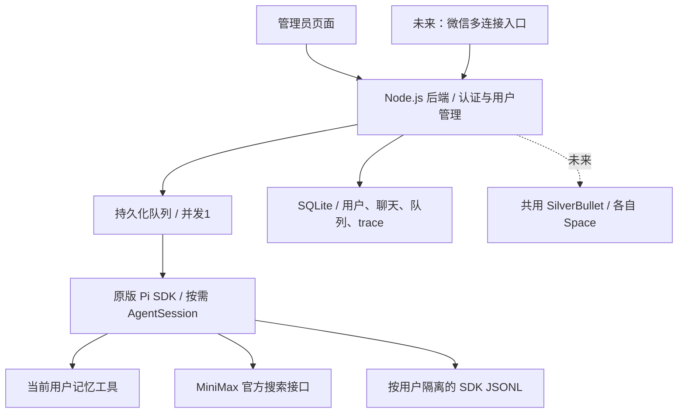

# pi-agent-multi-tenant

一键连接微信的多租户个人助手。目标是一个管理员控制台、一个 Pi SDK 后端、按用户隔离的数据，以及共用的 SilverBullet 等基础服务。

**当前版本：第一阶段开发版，不是已完成的微信多用户产品。** 现有个人助手独立运行，本项目没有修改其 Pi 配置、微信绑定、记忆、任务或 SilverBullet。

## 已实现

- 管理员登录、创建普通用户、用户列表；没有用户聊天页面。
- 服务端认证确定身份，客户端传入的 `userId` 不会切换身份。
- 独立的记忆、聊天、会话恢复和 trace；跨用户的资源 ID 返回 404。
- 一个 Pi SDK 服务进程，全局串行执行；持久化队列，上限20条，每用户等待上限5条。
- 使用原版 Pi SDK 1.1.0 创建独立 `AgentSession`，每次运行完成后释放；按用户保存 JSONL 会话。
- 显式资源和凭据配置，不发现宿主机的 AGENTS、技能、扩展、默认会话或生产记忆。
- 只开放当前用户的 `memory_read`、`memory_write`，以及可选 MiniMax 官方 `web_search`；没有宿主机 bash/read/write。
- Trace 保存注入提示词、记忆、SDK消息及工具事件；尚未复用旧 trace 网页，也不宣称已捕获全部原始 HTTP 请求。
- 密码 scrypt、会话 token 只存摘要、过期和退出撤销、HttpOnly/SameSite Cookie、请求体与登录并发限制。

## 仍需实现

1. 管理员为用户生成微信登录二维码，扫码结果安全绑定对应用户；多连接入口和消息投递。
2. 自动创建用户的 SilverBullet Space、人类账号和独立 Agent 账号/token；跨 Space 验证。
3. 持久化定时任务及用户消息投递，任务不依赖会话对象常驻。
4. 受限健康/投资工具、历史关键词搜索、管理员 trace 查看页面、用户禁用、额度统计和限额。
5. 需要通用脚本时增加独立沙箱；上线前完成 HTTPS 入口、备份恢复和容量测试。

管理员页面目前明确显示“微信未绑定”，没有假二维码。用户后续只需扫码并在微信使用；如直接浏览笔记，仍访问自己的 SilverBullet 页面。

## 架构



这是应用层数据隔离。服务端运行账号及主机管理员仍能读取数据；不要把此版本当作允许用户运行任意宿主机命令的沙箱。

## 本地运行和测试

Node.js >=22.19。模拟模式及测试只使用 Node 内置模块，不需要安装 npm 依赖。

```sh
npm test
cp .env.example .env
# 在 .env 设置一个至少12位的独立 ASSISTANT_ADMIN_PASSWORD。
node --env-file=.env src/main.mjs
```

管理台：`http://127.0.0.1:32214`，初始管理员名 `admin`。服务默认 mock 模式，页面会明确标注；mock 不会调用真实模型。初始密码只用于数据库第一次创建管理员，不会在重启时覆盖已有密码。

`.env`、`.data/`、数据库、会话和凭据不入 Git。数据根目录0700、数据库0600；服务启动设置umask077。

## 真实 Pi 模式

在独立开发环境安装/提供 `@earendil-works/pi-coding-agent@1.1.0`，或把 `PI_SDK_MODULE` 设为其已安装的 `dist/index.js` 绝对路径。不要重装或升级生产 Pi 来满足开发依赖。

设置：

```dotenv
ASSISTANT_ENGINE=pi
PI_SDK_MODULE=/path/to/pi-coding-agent/dist/index.js
ASSISTANT_MODELS_FILE=/path/to/models.json
MINIMAX_CN_API_KEY=<通过私有环境文件提供>
ASSISTANT_SEARCH=on
```

本仓库 `models.json` 无凭据，配置 MiniMax M3.1 Flash Preview、medium、每次最多8192输出 tokens。凭据由 `ModelRuntime` 显式提供，不切换进程的 HOME、cwd 或环境变量。

搜索直接调用已经验证过的官方 `/v1/coding_plan/search` 接口，使用一个受限 SDK 工具，避免每个会话重复启动 MCP 子进程。当前所有用户共用后台提供的模型/搜索密钥；按用户凭据与计量属于后续版本。

## 数据与接口

数据根目录默认 `.data/`：

```text
assistant.sqlite                 用户、token摘要、记忆、聊天、队列、trace
tenants/<服务端生成的UUID>/
  workspace/                    独立工作目录
  sessions/                     Pi SDK原生JSONL会话
  agent/                        独立SDK配置/运行状态
```

| 接口 | 权限与作用 |
|---|---|
| `POST /api/login`、`POST /api/logout` | 登录、撤销当前会话 |
| `GET /api/admin/users`、`POST /api/admin/users` | 仅管理员，列出/创建普通用户 |
| `GET/PUT /api/memory` | 当前用户的记忆 |
| `GET/POST /api/conversations` | 当前用户的会话 |
| `GET /api/conversations/:id/messages` | 当前用户的聊天 |
| `POST /api/conversations/:id/runs` | 提交运行，立即返回202与run ID |
| `GET /api/runs/:id`、`GET /api/runs/:id/trace` | 当前用户的运行与trace |

Cookie供管理台使用，Bearer供集成/测试使用。用户权限不接受请求正文、URL参数或模型输出中的身份声明。每次查询与工具闭包都绑定认证用户。

重启后继续执行等待任务；已开始但未完成的任务标为 interrupted，不自动重放，以免重复副作用。运行超过120秒发出abort，等待实际引擎结束后才开始下一个任务，不通过并行“绕过”超时。引擎错误详情仅保存在对应用户trace，已知模型密钥会脱敏。

## 独立服务器开发环境

本机管理环境可运行 `scripts/deploy-dev.py`。该脚本含现有主机路径，是开发部署适配器，不是通用生产安装器。只复制源码和模板，不传私人数据或凭据。

- 源码：`/home/admin/pi-agent-multi-tenant-dev`
- 独立状态：`/home/admin/.local/share/pi-agent-multi-tenant-dev`
- 私有管理员登录文件：`/home/admin/.config/pi-agent-multi-tenant-dev/login.json`，0600
- 独立tmux：`pi-multi-tenant-dev`
- 监听：仅 `127.0.0.1:32214`，没有修改公网Nginx路由
- 现有个人助手：`pi-wechat`，保持原状

管理台可经SSH隧道访问。上线前应配置 HTTPS、`ASSISTANT_SECURE_COOKIES=on` 和固定 `ASSISTANT_ORIGIN`；此开发入口不直接开放公网。

## 验证结果

2026-10-13，自动测试覆盖认证、权限、跨用户记忆/聊天/run/trace、Origin、请求体限制、串行队列、失败恢复、超时、过期与重启恢复。

独立服务器的真实 Pi SDK 测试已通过：两个虚构用户调用memory_read，返回各自测试代号，系统记忆注入正确；跨用户trace404；恢复SDK历史正确；官方搜索成功。生产个人助手的进程与配置未变，原trace HTTP200。报告见 `test/live-verification.json`，没有私人聊天正文或密钥。

开发服务测试后的RSS约160MiB，是两名虚构用户串行测试的测量，不能当作多人容量承诺。现有小服务器先保持并发1；规模增加后再评估数据库迁移、后端副本和工具沙箱。

后续会话先读 [HANDOFF.md](HANDOFF.md)。
