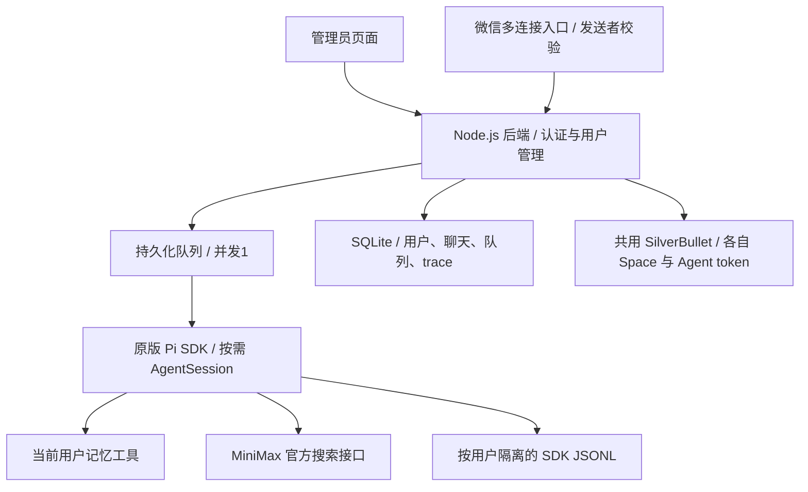

# pi-agent-multi-tenant

一键连接微信的多租户个人助手。目标是一个管理员控制台、一个 Pi SDK 后端、按用户隔离的数据，以及共用的 SilverBullet 等基础服务。

**当前版本：可扫码接入的独立服务，已部署。** 管理地址为 `https://123.56.157.198:32651/assistant/`，使用现有管理员密码网关，后台账号为 admin；后台密码保存在本机 `alibaba_host/config/multi-tenant-login.json` 和服务器 `/home/admin/.config/pi-agent-multi-tenant/login.json`，不进Git。管理员创建用户后让本人扫码，并先在微信发一条消息。真实二维码、模型调用与已有用户微信收发元数据已验证。

已增加邀请注册与用户自助页：`https://123.56.157.198:32651/assistant/account`。用户不需要管理员网关口令；管理员在原后台生成7天有效的一次性邀请，用户凭链接注册、登录、绑定自己的微信，设置笔记用户名和人物设定。公开注册必须有有效邀请，管理员仍可手动创建用户。

## 已实现

- 管理员登录、创建普通用户、用户列表；没有用户聊天页面。
- 服务端认证确定身份，客户端传入的 `userId` 不会切换身份。
- 独立的记忆、聊天、会话恢复和 trace；跨用户的资源 ID 返回 404。
- 一个 Pi SDK 服务进程，全局串行执行；持久化队列，上限20条，每用户等待上限5条。
- 使用原版 Pi SDK 1.1.0 创建独立 `AgentSession`，每次运行完成后释放；按用户保存 JSONL 会话。
- 显式资源和凭据配置，不发现宿主机的 AGENTS、技能、扩展、默认会话或生产记忆。
- 只开放当前用户的 `memory_read`、`memory_write`，以及可选 MiniMax 官方 `web_search`；没有宿主机 bash/read/write；可选cmd在独立沙箱中执行。
- Trace 保存注入提示词、记忆、SDK消息及工具事件；尚未复用旧 trace 网页，也不宣称已捕获全部原始 HTTP 请求。
- 管理员可按用户查看最近50次运行，展开提示词、注入记忆、SDK与工具事件、结果和错误；普通用户不能访问管理员接口，错配用户与run ID返回404。
- 密码 scrypt、会话 token 只存摘要、过期和退出撤销、HttpOnly/SameSite Cookie、请求体与登录并发限制。
- 管理员按用户生成微信二维码、查看扫码状态、取消和解绑；连接按用户独立长轮询，支持文本和语音转写文本。
- 每条微信聊天消息开始执行前，先发送“✅ 已收到，pi 处理中...”，完成后再发送结果；提示最多等待5秒，失败不阻塞任务，不补发迟到提示。网页任务和定时提醒不发送该提示。
- 微信发送者先校验再写入队列，持久化游标与消息去重；回复失败留在数据库重试。稳定发送ID不代表微信接口提供严格的恰好一次投递，网络故障时仍可能重复回复。
- 解绑保留微信身份归属，重新绑定必须是原微信用户，不能换人继承记忆。原个人助手身份可加入保护名单，不导入其微信token或聊天。
- 自动创建 SilverBullet 人类账号、非管理员 Agent 账号、私有 Space 和受限 token；模型只获得当前用户的 `note_read`、`note_write` 工具。
- 笔记写入使用 ETag 防止覆盖其他修改；管理员可显式查看人类登录信息，Agent token 不返回管理页面或模型。
- 持久化的一次性／每日文本提醒，管理员页面和模型的 reminder_create/list/cancel 工具均限定当前用户。时间需包含时区，默认北京时间；每日按24小时重复，不调用模型生成提醒。
- 邀请只存SHA256摘要，可撤销、过期、一次性消费；注册角色固定user。链接token放在URL fragment，注册通过POST提交，避免进入Nginx访问日志中的请求URL。
- 用户自助设置笔记用户名，主页与笔记使用同一密码，改名保留原Space、Agent token和笔记。用户自设的笔记密码不在应用数据库保留明文，管理员页面不再展示其密码。新注册时笔记密码同步为主页密码；修改主页密码同步修改笔记密码，失败时保留主页旧密码。旧用户在自助页面验证主页密码后主动统一，普通登录不重置原笔记密码。
- 每用户人物设定（底层AGENTS.md，最多8000字符），数据库为配置来源，镜像写入 `tenants/<uuid>/workspace/AGENTS.md`，后续模型请求显式注入并进入trace。手工修改镜像文件不等于修改配置；不发现宿主机AGENTS、技能或扩展，工具权限不变。

- 查询当前日期或时间使用专用 `time_now`，返回UTC和北京时间。多用户后端不开放宿主机cmd/bash；`agent.md`、`AGENTS.md`和人物设定均由固定当前用户的persona工具读写，无需通用文件权限。
- 人物设定可手动编辑或由网页AI生成草稿后确认保存；草稿运行只开放persona_read，禁止写记忆、笔记、提醒和设定。微信明确要求修改时可调用persona_read/write，固定到当前用户。

## 仍需实现

1. 微信长时间运行、会话过期和异常网络下的重连验证。
2. 多人容量及长时间运行验证，服务器资源上限已配置，不作为容量承诺。
3. 定时模型复盘和复杂周期，目前只支持一次性／每日文本提醒。
4. 受限健康/投资工具、历史关键词搜索、用户禁用、额度统计和限额；运行记录页面后续补刷新与筛选。
5. 需要通用脚本时增加独立沙箱；扩容前完成容量及完整恢复演练。

管理员可直接建用户并展示微信二维码，也可发送邀请让用户自己注册、绑定。自助页只管理账号、微信、笔记登录与偏好，没有网页聊天。用户聊天继续使用微信，笔记使用自己的 SilverBullet 页面。

已有用户需要进入自助页时，在邀请用途选择“激活已有账号”。接受邀请会设置该账号的网页登录密码，保持原UUID、微信归属和私人数据，撤销旧网页登录会话；用户名仍是原账号名。重新生成或修改密码会撤销旧的已有账号激活邀请。只把此类邀请交给原账号本人。

## 架构



这是应用层数据隔离。服务端运行账号及主机管理员仍能读取数据；不要把此版本当作允许用户运行任意宿主机命令的沙箱。

## 本地运行和测试

Node.js >=22.19。第二阶段增加本地生成二维码依赖，先安装锁定依赖。自动测试使用模拟微信，不扫描或绑定真实账号。

```sh
npm ci --omit=peer --ignore-scripts --no-audit --no-fund
npm test
cp .env.example .env
# 在 .env 设置一个至少12位的独立 ASSISTANT_ADMIN_PASSWORD。
node --env-file=.env src/main.mjs
```

管理台：`http://127.0.0.1:32214`，初始管理员名 `admin`。服务默认 mock 模式，页面会明确标注；mock 不会调用真实模型。初始密码只用于数据库第一次创建管理员，不会在重启时覆盖已有密码。

`.env`、`.data/`、数据库、会话和凭据不入 Git。数据根目录0700、数据库0600；服务启动设置umask077。

## 真实 Pi 模式

运行 `npm run setup:pi` 安装独立的锁定 SDK，默认使用 `sdk-runtime/node_modules/`。SDK 1.1.0 的部分依赖使用宽松版本范围，会解析到不兼容的 1.2.0，因此 `sdk-runtime/package.json` 同时固定其配套包，不只固定顶层版本。也可显式设置 `PI_SDK_MODULE` 为已验证的 SDK 入口。不要重装或升级生产 Pi 来满足开发依赖。

设置：

```dotenv
ASSISTANT_ENGINE=pi
# 留空使用 sdk-runtime；如指定其他路径，需验证完整配套依赖版本。
PI_SDK_MODULE=
ASSISTANT_MODELS_FILE=/path/to/models.json
MINIMAX_CN_API_KEY=<通过私有环境文件提供>
ASSISTANT_SEARCH=on
```

本仓库 `models.json` 无凭据，配置 MiniMax M3.1 Flash Preview、medium、每次最多8192输出 tokens。凭据由 `ModelRuntime` 显式提供，不切换进程的 HOME、cwd 或环境变量。

搜索直接调用已经验证过的官方 `/v1/coding_plan/search` 接口，使用一个受限 SDK 工具，避免每个会话重复启动 MCP 子进程。当前所有用户共用后台提供的模型/搜索密钥；按用户凭据与计量属于后续版本。

## 数据与接口

数据根目录默认 `.data/`：

```text
assistant.sqlite                 用户、token摘要、记忆、聊天、队列、trace
tenants/<服务端生成的UUID>/
  workspace/                    独立工作目录
  sessions/                     Pi SDK原生JSONL会话
  agent/                        独立SDK配置/运行状态
```

| 接口 | 权限与作用 |
|---|---|
| `POST /api/login`、`POST /api/logout` | 登录、撤销当前会话 |
| `GET /api/admin/users`、`POST /api/admin/users` | 仅管理员，列出/创建普通用户 |
| `GET/PUT /api/memory` | 当前用户的记忆 |
| `GET/POST /api/conversations` | 当前用户的会话 |
| `GET /api/conversations/:id/messages` | 当前用户的聊天 |
| `POST /api/conversations/:id/runs` | 提交运行，立即返回202与run ID |
| `GET /api/runs/:id`、`GET /api/runs/:id/trace` | 当前用户的运行与trace |
| `POST /api/admin/users/:id/wechat/login` | 管理员生成当前用户二维码 |
| `GET/DELETE /api/admin/users/:id/wechat/login/:attempt` | 管理员查看或取消扫码 |
| `DELETE /api/admin/users/:id/wechat` | 管理员解绑，保留原身份归属 |
| `GET/POST /api/admin/users/:id/silverbullet` | 管理员查看状态或配置 Space |
| `POST /api/admin/users/:id/silverbullet/credentials` | 管理员显式查看人类登录信息 |
| `GET /api/admin/users/:id/runs` | 管理员查看指定用户最近50次运行 |
| `GET /api/admin/users/:id/runs/:runId/trace` | 管理员查看指定用户运行详情，错配ID返回404 |
| `GET/POST /api/admin/users/:id/reminders` | 管理员查看／添加对应用户提醒 |
| `DELETE /api/admin/users/:id/reminders/:id` | 管理员取消对应用户提醒及尚未投递的提醒 |
| `GET/POST /api/admin/invites`、`DELETE /api/admin/invites/:id` | 管理员查看／生成／撤销邀请 |
| `POST /api/invitation`、`POST /api/register` | 验证邀请及受邀注册，无有效邀请不能注册 |
| `GET /api/account`、`GET/PUT /api/account/agents` | 普通用户自己的状态及人物设定 |
| `POST /api/account/password` | 校验旧密码后同步修改主页和笔记密码，撤销旧会话 |
| `POST /api/account/persona-assist`、`GET /api/account/persona-assist/:runId` | 当前用户的AI人物设定草稿，生成不保存 |
| `/api/account/wechat/...` | 已登录用户自己的扫码状态及绑定操作 |
| `POST /api/account/silverbullet/login` | 验证主页密码，修改笔记用户名并统一密码；不接受其他用户ID |
| `GET/PUT /api/notes/:encodedPage` | 当前用户的笔记，写入已有笔记需 ETag |

Cookie供管理台使用，Bearer供集成/测试使用。用户权限不接受请求正文、URL参数或模型输出中的身份声明。每次查询与工具闭包都绑定认证用户。

重启后继续执行等待任务；已开始但未完成的任务标为 interrupted，不自动重放，以免重复副作用。运行超过120秒发出abort，等待实际引擎结束后才开始下一个任务，不通过并行“绕过”超时。引擎错误详情仅保存在对应用户trace，已知模型密钥会脱敏。

## 独立服务器开发环境

服务器恢复并确认个人助手正常后，才执行远程部署。`scripts/deploy-dev.py` 是现有主机的开发适配器，只重启独立开发 tmux，但会安装依赖并读取现有私有模型环境；需先确认开发队列空闲和服务器资源充足。源码归档不含真实数据或凭据。它生成个人微信身份保护名单，仅记录身份ID，不复制微信token。

- 源码：`/home/admin/pi-agent-multi-tenant-dev`
- 独立状态：`/home/admin/.local/share/pi-agent-multi-tenant-dev`
- 私有管理员登录文件：`/home/admin/.config/pi-agent-multi-tenant-dev/login.json`，0600
- 独立tmux：`pi-multi-tenant-dev`
- 监听：仅 `127.0.0.1:32214`，没有修改公网Nginx路由
- 现有个人助手：`pi-wechat`，保持原状

管理台可经SSH隧道访问。上线前应配置 HTTPS、`ASSISTANT_SECURE_COOKIES=on` 和固定 `ASSISTANT_ORIGIN`；此开发入口不直接开放公网。

## 当前上线部署

`scripts/deploy-live.py` 部署到 `/home/admin/pi-agent-multi-tenant-live`，状态为 `/home/admin/.local/share/pi-agent-multi-tenant/data`，私有配置为 `/home/admin/.config/pi-agent-multi-tenant`。它与旧开发实例、个人Pi的状态分开。`pi-multi-tenant.service` 已启用开机启动，异常退出自动重启；MemoryHigh=256MiB、MemoryMax=384MiB、CPUQuota=50%，超限可能终止本后台，不会借此扩大个人助手权限。

后台仅监听127.0.0.1:32215，`ASSISTANT_BASE_PATH=/assistant`、Secure Cookie、固定Origin均已启用。现有Nginx32651保护管理台及管理员接口，个人trace仍在原根路径。用户account/join页面和所需登录、自助接口允许通过应用自身认证访问，普通用户不会获得管理员网关口令。新笔记容器 `silverbullet-multi-tenant` 监听127.0.0.1:32216，数据为 `/opt/pi-agent-multi-tenant-sb/data`，restart=unless-stopped，限制128MiB/0.25CPU。

`/users/<uuid>/` 使用SilverBullet自身账号及Space权限，**不共享管理员网关口令**。笔记用户可用其人类账号登录自己的空间；后台和个人trace仍要求管理员网关认证。Agent token只用于服务器内部访问。原生认证路由 `/.auth/central/` 也转发到笔记服务；server-config.primaryUrl必须为公网Origin，不能填内部loopback地址，否则浏览器跳转失败。内部管理请求使用公共Host和HTTPS代理头。路由位于 `/etc/nginx/pi-app-routes.d/pi-multi-tenant.conf`。

重新部署会短暂停止本后台。脚本拒绝队列中有运行或等待任务的部署，先检查可用内存，恢复后再启动。不要同时启动开发实例导入正式状态，或重载个人Pi来更新本项目。部署失败可能需要人工恢复，当前脚本不是支持原子回滚的发布系统。

仅更新源码使用 `scripts/update-live.py`：队列空闲后停止独立后台，备份数据库、源码和Nginx路由到私有 `backups/`，更新后检查健康、原用户/绑定和个人Pi PID。失败时恢复原代码及路由，不覆盖在线数据库；此脚本不安装或升级依赖。

```sh
systemctl status pi-multi-tenant
journalctl -u pi-multi-tenant --no-pager -n 30
docker ps --filter name=silverbullet-multi-tenant
```

提醒到期时，如果微信未连接或用户还没发过消息，会保留为 waiting_for_wechat；有可用上下文后投递。完成状态表示已排入持久化发送队列，不代表微信已送达。离线期间错过多次每日提醒只补一条，不补发全部历史日期。微信接口拒绝旧上下文或token失效时可能需要用户再发消息或重新扫码；不保证任意时长的主动通知。

### 微信与 SilverBullet 配置

设置 `ASSISTANT_WECHAT=on` 才会请求真实微信二维码。`ASSISTANT_WECHAT_PROTECTION` 指向私有JSON，格式为 `{"protectedBots":[],"protectedUsers":[]}`；把现有个人助手身份加入其中，测试时使用另一个微信账号。已有保护名单仍不能防止用户扫码本身在微信侧造成的登录变化，因此不要用生产微信做开发扫码实验。

`ASSISTANT_SB_CONFIG` 指向私有JSON，包含 `baseUrl`、可选 `publicUrl`、`username`、`password`。例如地址为 `http://127.0.0.1:32216`，账号为独立开发 SB 管理员；文件权限0600，密码不放 Git。开发脚本 `scripts/deploy-sb-dev.py` 创建独立容器 `silverbullet-multi-tenant-dev`、回环端口32216、状态目录 `/opt/pi-agent-multi-tenant-sb-dev/data`，限制128MiB和0.25CPU，不修改个人 SilverBullet。其资源上限尚未做负载验收。

生产方案可以共用一个 SilverBullet 实例，通过每个用户的 Space 和账号隔离；开发验证先使用独立实例。每个 Space 的匿名权限为 none，只有对应人类与 Agent 账号具有 write 权限，runtime API 和 shell 关闭。

### 备份、恢复和迁移

先正常停止本项目服务，等待队列和连接关闭，再备份整个 `ASSISTANT_DATA_DIR`，包括 SQLite、WAL/SHM（若仍存在）和 `tenants/` 下的 SDK 会话。数据库包含微信token和 SB 凭据，是私有运行数据，不能上传 Git。同步备份独立私有配置、模型环境文件和对应 SilverBullet 的完整 `/data`；Space、账号、token 与数据库需要匹配。

迁移到新主机后安装锁定依赖，恢复以上目录及权限，更新 `baseUrl`、`publicUrl`、数据路径与HTTPS入口，然后启动一个后端实例。不要让旧新两个实例同时使用同一组微信绑定或同一个 SQLite 文件。等待任务会恢复，执行中任务标记 interrupted，不自动重复执行；待回复消息会恢复投递。微信token失效时需原用户重新扫码。

## 验证结果

2026-10-13，43项Node自动测试及5项Python工作区池测试通过，覆盖认证、权限、跨用户记忆/聊天/run/trace、Origin、请求体限制、串行队列、失败恢复、超时、扫码取消/过期/身份保护、发送者校验、投递重试、重启恢复、管理员trace权限、提醒持久化、时区/日期校验、漏执行合并，以及邀请、用户自助AGENTS隔离、笔记账号改名与丢失响应恢复。

独立服务器的真实 Pi SDK 测试已通过：两个虚构用户调用memory_read，返回各自测试代号，系统记忆注入正确；跨用户trace404；恢复SDK历史正确；官方搜索成功。生产个人助手的进程与配置未变，原trace HTTP200。报告见 `test/live-verification.json`，没有私人聊天正文或密钥。

开发服务测试后的RSS约160MiB，是两名虚构用户串行测试的测量，不能当作多人容量承诺。现有小服务器先保持并发1；规模增加后再评估数据库迁移、后端副本和工具沙箱。

第二阶段真实 SilverBullet 2.12.0 隔离容器测试通过：两用户账号和 Space、真实 Agent token 跨 Space 拒绝、匿名拒绝、ETag 冲突和幂等配置；真实 Pi SDK 的笔记写入、读取及跨用户 trace 拒绝也通过，见 `test/sb-live-verification.json`。服务器 `scripts/verify-live.mjs` 已验证真实模型记忆工具、提醒工具加载、独立SB隔离及真实微信二维码，未扫码或向微信发测试消息。

公网TLS验证、匿名401、登录、Secure且限定路径的Cookie及退出撤销已通过。浏览器验收使用临时公开Playwright容器，程序见 `scripts/verify-ui.mjs`、`scripts/verify-ui-container.py`；生成的虚构账号通过 `cleanup-ui-probe.py` 限定所有权后清理。此检查不代替真人微信收发验收。

`verify-invites-ui.mjs` 已实测无需管理员口令的邀请注册、拒绝重复邀请、人物设定保存、AI只读草稿生成、用户自选笔记用户名并登录、用户密码不保留、扫码PNG、统一密码修改后重新登录笔记与旧网页会话撤销；用户访问管理接口和个人trace均401，JS错误0。真实Pi模型上下文已验证AGENTS内容注入且bash/read/write/edit不在工具名单。后续真实用户扫码及回复发送确认已有服务器元数据验证，未导出私人聊天正文。

后续会话先读 [HANDOFF.md](HANDOFF.md)。

2026-10-13 笔记认证排查：浏览器验证弹窗来自根路径原生认证请求落入管理员Basic网关，其后还有错误的primaryUrl内部地址。修复专用认证路由及公网Origin后，浏览器验收检查整个笔记导航无WWW-Authenticate挑战，登录后实际读取自身index.md成功；后台与个人trace继续401保护。


## 命令沙箱与工作区复用池（已上线）

多用户Pi使用cmd工具执行Bash/Python，默认目录为/work，直接联网关闭。time_now负责实时北京时间，人物设定仍由persona_read/write保存并同步用户自己的AGENTS.md，笔记由note工具操作。沙箱的文件目录与Pi的SDK会话/凭据目录分开，不把模型密钥或SB管理账号放进命令环境。

执行服务为pi-sandbox.service，Linux用户pi-sandbox，通过/run/pi-sandbox/runner.sock接受后端请求；主后端仅增加pi-sandbox-client辅助组。无公网沙箱端口，无Docker管理权限。root管理安装，实际用户命令为非root。Ubuntu AppArmor仅为/usr/bin/bwrap增加定向userns策略，未关闭全局限制。

池预建8个128MiB ext4磁盘镜像槽位，约100MiB可用于用户文件；UUID绑定保存在/var/lib/pi-sandbox/slots/owners.json。槽位一旦绑定仅用于该用户，跨命令及执行服务重启保留文件。每次命令创建全新mount/PID/network/user namespace和seccomp环境，复用只读/usr运行依赖及用户持久目录，没有常驻Shell进程池。已测简单命令中位约105ms（前一轮119ms），未把这个值当所有脚本的性能承诺。

磁盘镜像在/opt/pi-sandbox/disks/，通过独立fstab条目启动挂载；执行服务RequiresMountsFor依赖这些卷，未挂载时不启动。耗尽槽位返回sandbox_pool_full，不回退宿主机执行。扩容需一起增加镜像/挂载、调整安装脚本与PI_SANDBOX_POOL_SIZE，不能只增大环境数字。

全局最多1条命令，单任务192MiB内存、0.5CPU、64进程、30秒、原始stdout/stderr合计32KiB；整个执行服务256MiB内存上限。超时、取消和输出超限杀掉任务cgroup，防止遗留子进程。只读系统依赖，命令环境变量清空后按允许列表设置，socket/ptrace/新增namespace/io_uring等受seccomp限制。Bubblewrap仍共享宿主机内核，扩大到陌生用户任意代码前评估gVisor或独立执行节点。

首次安装与启用顺序：

```sh
python3 scripts/deploy-sandbox.py
# 将verify-sandbox.py在服务器运行，先验收隔离和资源限制。
python3 scripts/enable-sandbox.py
python3 scripts/update-live.py
```

安装/更新执行服务需确认无沙箱任务；update-live还会确认模型队列空闲、备份原状态并检查个人Pi不变。deploy-sandbox只控制独立执行服务，不重启个人Pi、SilverBullet或Docker。后端更新失败会恢复原代码；独立沙箱及其卷不随代码回滚删除。若只停用cmd，移除主服务10-sandbox.conf中的socket环境变量并在队列空闲时重启多用户后端，保留磁盘数据。

运维：

```sh
systemctl status pi-sandbox pi-multi-tenant
journalctl -u pi-sandbox --no-pager -n 30
sudo curl --unix-socket /run/pi-sandbox/runner.sock -H 'Content-Type: application/json' -d '{}' http://localhost/status
```

备份时等沙箱空闲并停止执行服务，然后备份owners.json及各slot/work文件目录（保留符号链接、不跟随链接），配合助手SQLite和各用户SDK目录备份。恢复到同规格空槽位，保留UUID到槽位映射、恢复目录属主pi-sandbox，再启动执行服务。迁移时保留当前助手目录路径，改变路径还需调整SDK会话路径映射。运行中直接复制挂载着的磁盘镜像不作为一致性备份方式。

真实验收：verify-sandbox.py测试文件复用、用户隔离、网络/宿主机密钥不可访问、符号链接、内存/磁盘/输出上限、超时和取消及子进程清理；verify-user-sandbox.mjs用普通合成账号验证模型调用time_now、persona_read/write和cmd，并清理测试账号/Space/槽位。真实服务重启后文件复用和二进制输出传输也通过。报告见test/sandbox-live-verification.json。所有测试未通过真实微信发送消息。
