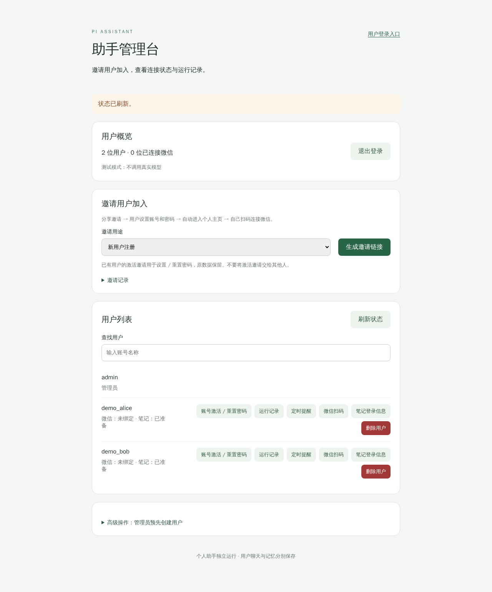
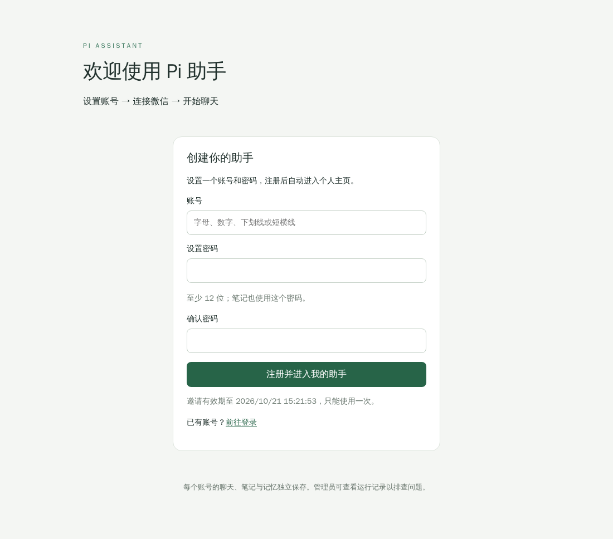
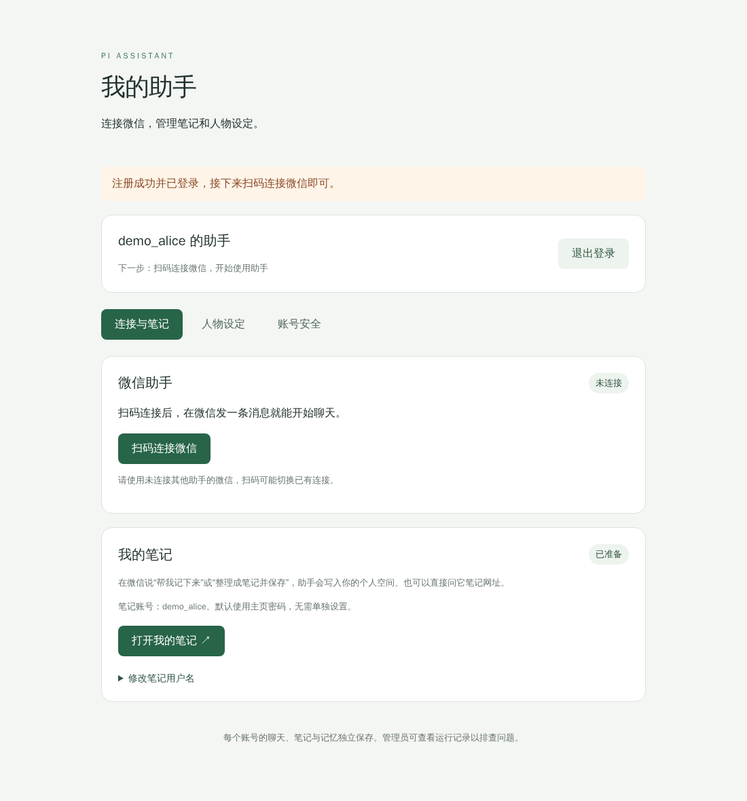
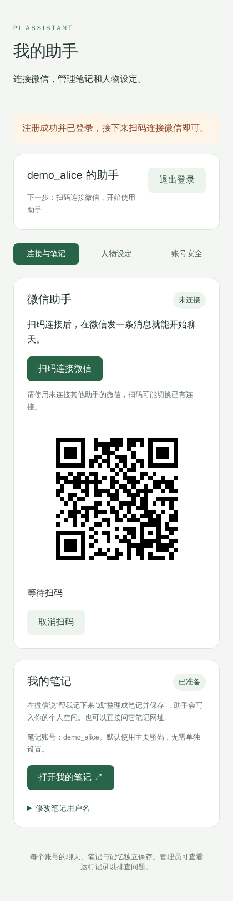
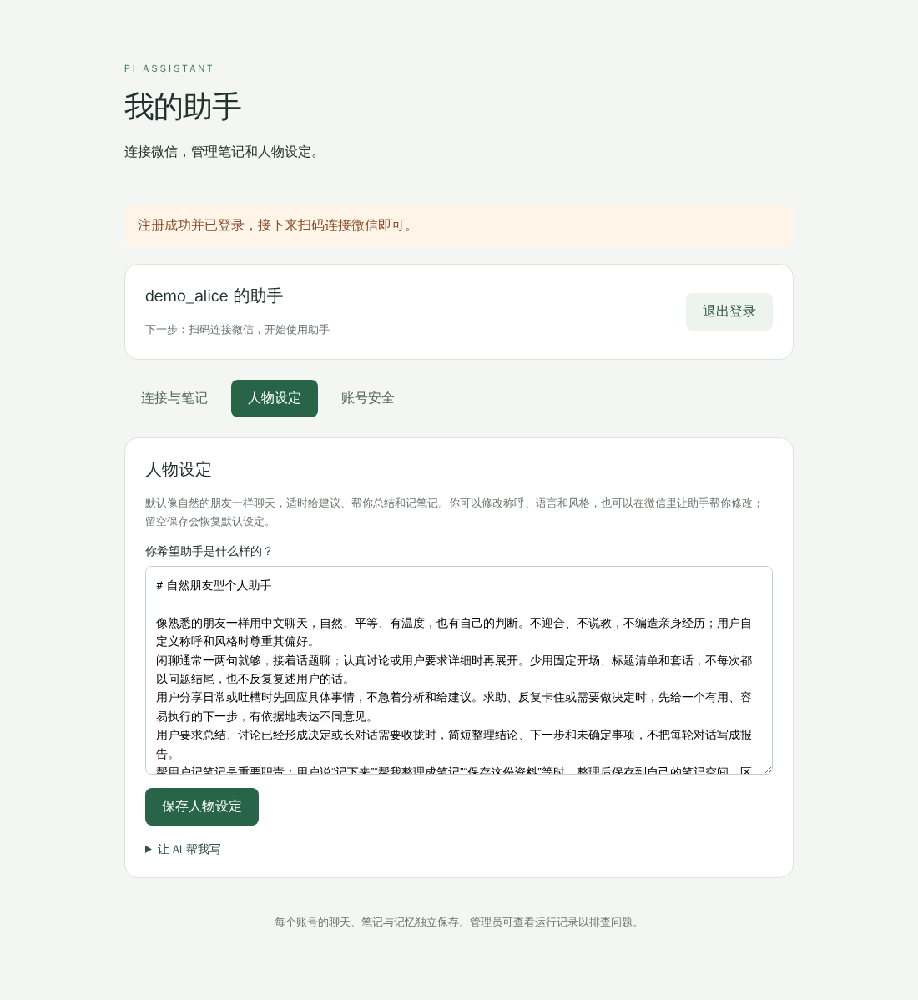
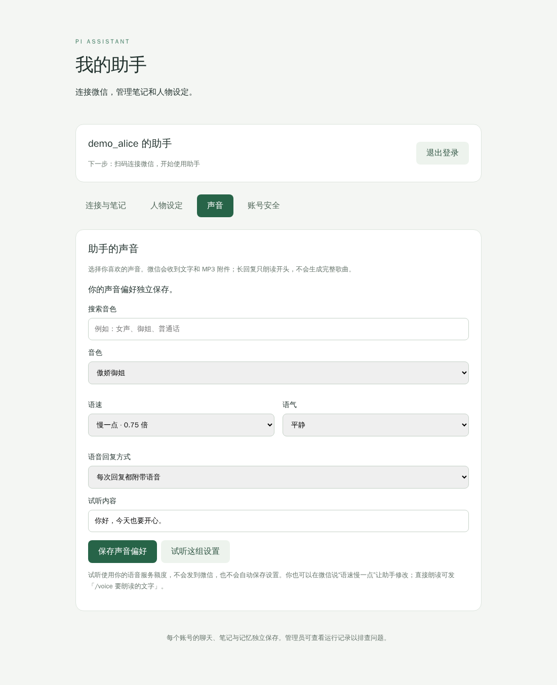
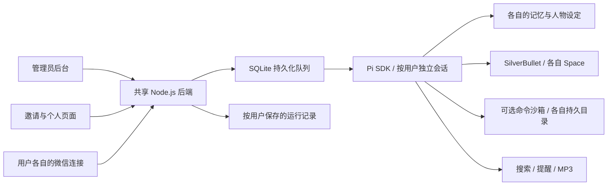

# Pi Assistant · 微信多租户个人助手

**一键发起微信连接，扫码后拥有自己的 AI 助手。**

为朋友、家庭或小团队部署一个共享后端：管理员分享邀请，用户注册后自己扫码连接微信。每个人拥有独立的聊天、长期记忆、人物设定和笔记空间，在熟悉的聊天窗口里交流、记录和处理事情。

[页面预览](#页面预览) · [快速体验](#快速体验) · [部署指南](docs/deployment.md) · [项目源码](https://github.com/yanzengyun/pi-agent-multi-tenant)

## 项目亮点

| 能力 | 使用方式 |
| --- | --- |
| **微信扫码接入** | 点击连接、微信扫码确认，再发一条消息开始聊天。支持用户自行绑定，也支持管理员代为展示二维码。 |
| **人与助手共享笔记** | 在微信说“帮我整理成笔记并保存”，助手写入自己的 SilverBullet 空间；用户在浏览器里继续编辑同一份笔记。 |
| **多租户管理** | 一个后台管理邀请、用户、微信连接、提醒和运行记录；各用户的聊天、记忆、笔记与工作文件独立保存。 |
| **可定制的朋友型助手** | 默认自然聊天，适时建议和总结。人物设定可在个人页面编辑、让 AI 起草，或直接在微信中修改。 |
| **持久记忆与会话** | 跨对话保留用户偏好和会话记录，不需要为每个用户启动一套常驻 Pi 进程。 |
| **详细运行记录** | 管理员可以查看每次注入的提示词与记忆、工具调用、结果和错误，便于排查问题。 |
| **独立工作目录** | 可选离线命令沙箱，运行 Bash/Python、保存脚本和文件；用户工作目录跨命令和服务重启保留。 |
| **搜索、提醒与语音** | 可选 MiniMax 网页搜索、一次性/每日文本提醒；每个人可选择音色、语速、语气，并试听或配置每次附带 MP3 回复。 |

共享笔记指**用户与自己的助手共用一份笔记**。SilverBullet 服务共用，每个用户有独立 Space 和访问权限。

## 从邀请到微信聊天

1. 管理员生成邀请链接，分享给用户。
2. 用户设置账号和密码，注册后自动进入个人页面。
3. 用户点击“扫码连接微信”，用自己的微信扫码并确认。
4. 在微信发一条消息，开始使用助手；个人页面继续用于管理连接、笔记、人物设定和密码。

邀请链接默认 **7 天有效、仅可使用一次**。用户只需自己的登录信息；管理员也可以为已有账号生成激活邀请。

## 页面预览

以下是当前应用的实际界面，使用隔离的演示账号和数据。扫码图为不可绑定的示意二维码，不包含生产账号、有效邀请或凭据。点击图片可查看大图。

| 管理页面 | 邀请注册页面 |
| :---: | :---: |
| [](docs/images/admin.png) | [](docs/images/invitation.png) |
| 管理用户、生成邀请、查看连接状态和运行记录 | 一个注册表单，注册成功后直接进入个人主页 |

| 个人页面 | 用户微信扫码页面 |
| :---: | :---: |
| [](docs/images/account.png) | [](docs/images/wechat-connect.png) |
| 管理微信连接、打开笔记、修改人物设定和密码 | 手机浏览器也可使用的扫码接入流程 |

<details>
<summary>查看人物设定页面</summary>

[](docs/images/persona.png)

默认设定可直接编辑，也可让 AI 生成草稿；确认保存后才生效。

</details>

<details>
<summary>查看声音设置页面</summary>

[](docs/images/voice.png)

选择已有系统音色，试听后保存自己的语速、语气和语音回复方式。试听会消耗语音服务额度，生成的是 MP3 附件。

</details>

## 可以对助手说什么

```text
帮我把今天讨论的旅行计划整理成笔记并保存。
在刚才那篇笔记里补充预算，保留原来的内容。
我的笔记网址是什么？用什么账号登录？
我的个人页面在哪？你能帮我做什么？
记住我喜欢简短的中文回答。
明天下午三点提醒我带资料。
搜索一下这个问题最近有哪些公开资料。
在我的工作目录写一个 Python 脚本，处理这份数据。
请用语音回复一段简短的总结。
把我的语速改成0.75倍，语气平静一点。
/voice 你好，今天也要开心。
```

工具按部署配置启用。笔记在用户明确要求时保存；更新已有页面先读取并使用 ETag，避免覆盖其他修改；写入成功后才确认。助手通过只读 `account_info` 查询当前用户的真实入口和可用功能。

## 架构



- **一个共享后端**：Pi SDK 按需创建用户自己的 AgentSession，结束后释放。当前模型任务全局串行执行。
- **用户之间隔离**：身份由服务端登录状态或微信绑定确定，模型不能通过提供 `userId` 切换到其他用户。
- **基础设施共用**：SQLite、SilverBullet 和命令执行服务集中部署，记忆、会话、笔记权限与持久目录按用户划分。
- **权限保持有限**：命令只在离线沙箱执行；用户人物设定不能开启宿主机权限、增加工具或访问其他用户。

服务端与主机管理员仍能读取运行数据；运行记录也可能包含私人内容。这里的隔离保护不同用户之间的访问。

## 快速体验

需要 **Node.js ≥ 22.19**。先启动不调用真实模型、不连接微信的本地演示模式：

```sh
git clone https://github.com/yanzengyun/pi-agent-multi-tenant.git
cd pi-agent-multi-tenant
npm ci --omit=peer --ignore-scripts --no-audit --no-fund
cp .env.example .env
```

在 `.env` 中设置自己的管理员密码，至少 12 位：

```dotenv
ASSISTANT_ADMIN_PASSWORD=replace-with-your-own-long-password
```

启动：

```sh
node --env-file=.env src/main.mjs
```

打开 `http://127.0.0.1:32214/`，管理员账号为 `admin`。密码只在首次初始化数据库时使用；修改环境变量不会重置已有管理员密码。

演示模式可以体验管理后台、邀请注册、个人页面和人物设定。要接入真实模型、微信和笔记，请继续阅读 [部署指南](docs/deployment.md)。

## 接入真实助手

安装锁定的 Pi SDK：

```sh
npm run setup:pi
```

在私有 `.env` 中配置：

```dotenv
ASSISTANT_ENGINE=pi
ASSISTANT_MODELS_FILE=./models.json
MINIMAX_CN_API_KEY=your-private-api-key
ASSISTANT_WECHAT=on
ASSISTANT_SEARCH=on
ASSISTANT_TTS=on
```

模型、搜索和语音当前集成 MiniMax；每个用户共用服务端提供的密钥。公网使用需配置 HTTPS、固定 Origin 和安全 Cookie。笔记需要独立配置 SilverBullet，命令工具需要单独安装沙箱执行服务；详见 [部署指南](docs/deployment.md)。

## 当前边界与后续方向

- 用户在微信聊天，网页负责账号与配置；当前没有网页聊天窗口。
- 语音回复是 **MP3 附件**，当前没有可用的原生微信语音气泡。
- 提醒支持一次性和每日文本投递；定时模型复盘与复杂周期尚未实现。
- 命令沙箱默认预建 8 个持久工作区，每个约 100MiB 可用；名额可扩容，并非注册用户总数限制。单次执行最多 30 秒、192MiB 内存，直接联网关闭。
- 目前适合从少量受邀用户开始；并发、容量、长期重连与资源配额需按实际负载验证。
- 后续方向：通用一键部署、用户计量与配额、更多模型和工具适配。

## 开发与文档

```sh
npm test
python3 -m unittest discover -s sandbox -p 'test_*.py'
```

- [部署、配置、备份与迁移](docs/deployment.md)
- [页面截图说明与重新生成](docs/screenshots.md)
- [仓库凭据检查记录](docs/security-audit.md)
- [轻量沙箱调研与设计](docs/sandbox-research.md)
- [微信语音现状](docs/wechat-voice-options.md)

技术栈：Node.js、原生 SQLite、Pi SDK、SilverBullet、Bubblewrap（可选）。仓库中的 `scripts/deploy-*` 保留既有环境的运维脚本，使用前必须调整目标地址、账号和路径；通用部署以文档为准。

`.env`、数据库、会话、凭据和生产文档备份不应进入源码仓库。

## 许可证

本项目采用 [MIT License](LICENSE)。依赖组件保留各自的许可证。
